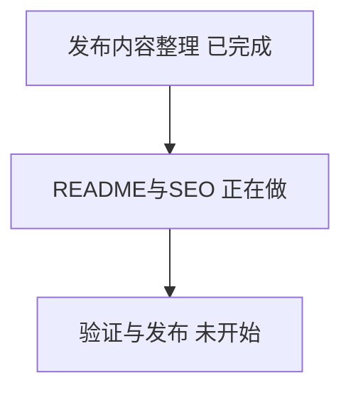
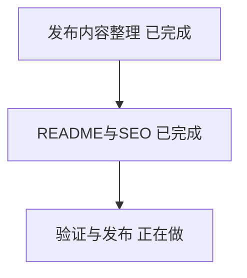

# 发布进度

## 2026-10-29 — 发布内容整理

已做：整理完整的 19 讲、4 项练习、代码导读与课程总览，并建立独立发布目录。原有长篇介绍保留在 course-guide.md，仓库 README 单独简化。

为什么：完整教程和简洁入口承担不同用途，因此保留课程总览而不直接删减内容；原始材料通过官方链接访问，避免依赖本机目录。

问题与验证：原教程的五类质量问题仍待修订，已在编写说明中明确列出。现有 HTML 依靠片段地址切换章节，需要增加能独立访问的章节页面，才能让搜索引擎识别每讲内容。

下一步：完成 README 和 SEO，检查独立章节、离线版及链接，再发布 GitHub 和网站。

## 2026-10-29 — README 与 SEO 完成

已做：完成简洁的中英文 README，保留完整 Markdown 与离线 HTML；生成 27 个有完整正文的独立页面，并为各页面设置标题、介绍、规范地址、分享信息和网站地图。仓库名选用 cs329z-chinese，About 与 Topics 将覆盖课程名称和实际教学主题。

为什么：GitHub 仓库检索会使用名称、介绍和主题，因此将 CS329Z、Stanford、Engineering AI Agents 放入相关入口；网页原来只用一个地址切换内容，现改为每篇都有自己的地址，同时保留单文件离线阅读。

问题与验证：19 讲、4 项实践、27 个页面、1,220 处本地链接与资源和网站地图检查通过；浏览器验证章节跳转、搜索结果及段落定位通过。原教程已发现的内容问题仍列在编写说明里；外部搜索引擎的收录时间和排名不能保证。

下一步：创建公开 GitHub 仓库，配置介绍和 Topics，发布网站更新并验证访问与 GitHub 搜索。

## 2026-10-29 — 验证与发布完成

已做：完整 Markdown、HTML 和简洁 README 已发布到公开仓库 https://github.com/wanghao-SunSky/cs329z-chinese ，默认分支为 main。About 包含课程中英文名称、内容介绍及在线入口；设置了 15 个与内容相符的 Topics。在线教程已更新至 https://cs329z-course-review-20261029.wanghao162263.chatgpt.site 。

为什么：分别做好仓库和网页的检索入口，让找课程的人能发现仓库，也能直接阅读各讲。公开访问检查发现托管平台会去掉章节地址末尾的 .html，因此已让页面标准地址和网站地图采用最终网址，本地 HTML 仍可直接打开。

问题与验证：GitHub 仓库搜索 cs329z、CS329Z 中文，以及描述中的精确短语 Engineering AI Agents 均返回本仓库；英文短语查询在第二页命中，不代表高排名。未登录的 GitHub API 确认仓库公开；浏览器确认 README、About、Topics 与在线阅读链接显示正确。27 个独立页面和 1,220 处本地链接与资源检查通过；线上首页、章节、robots.txt 与 sitemap.xml 返回成功，正文与发布源一致，章节标准地址与最终地址一致。托管平台会注入自身脚本；普通 Python 请求曾被平台拦截，正常浏览器与使用浏览器标识的公开请求通过，未验证搜索引擎实际抓取。Google、百度等收录及排名仍不可保证。原教程的五类质量问题继续在编写说明中列为待修订。

下一步：本次发布工作已完成；后续内容修订可通过 Issues 逐项记录，修改 Markdown 后重新构建并验证 HTML。

